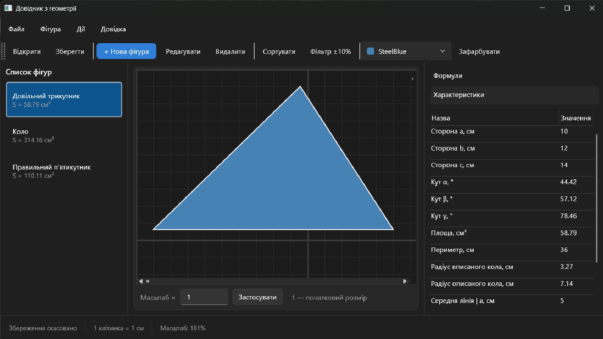
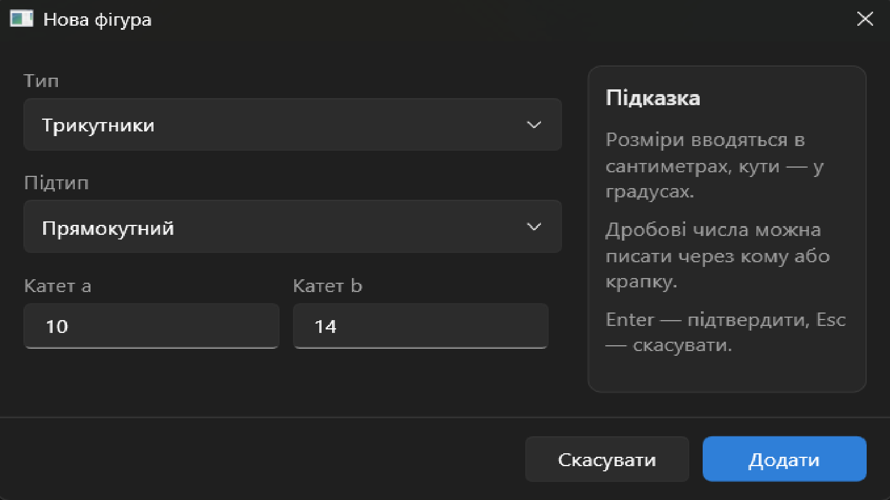
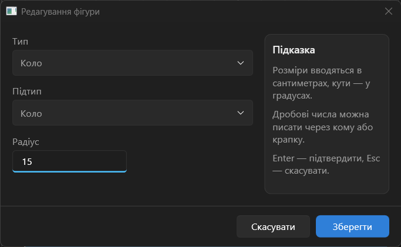
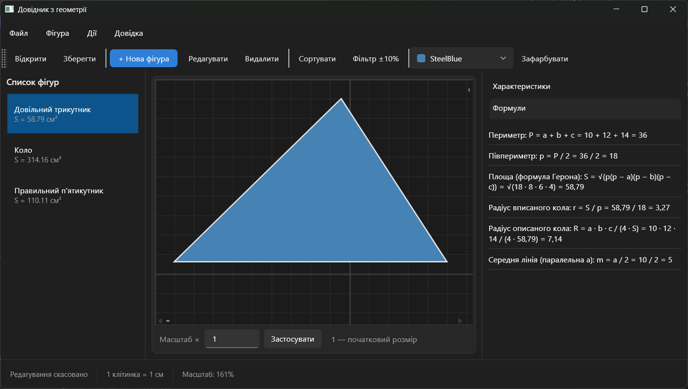
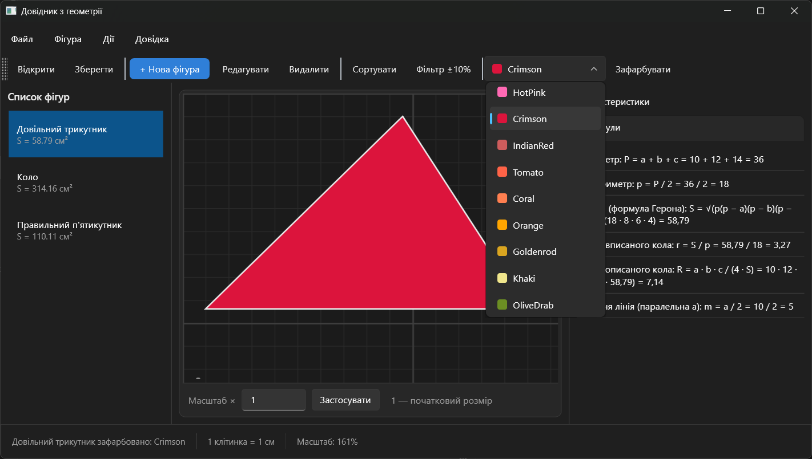
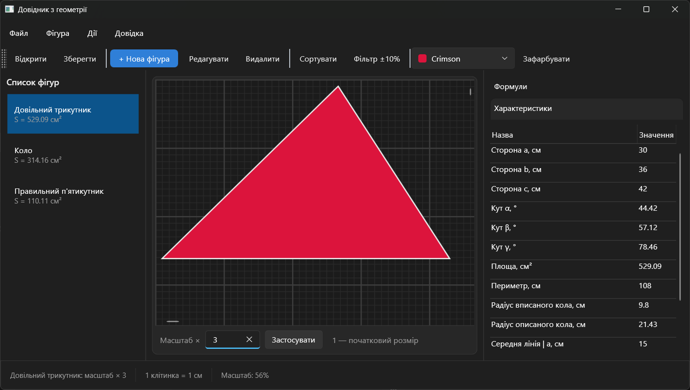
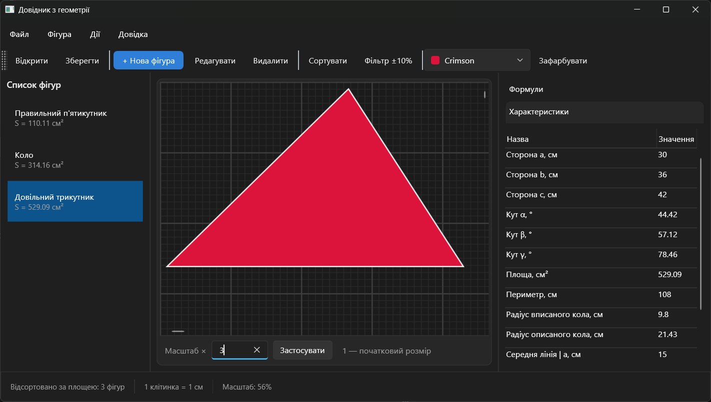
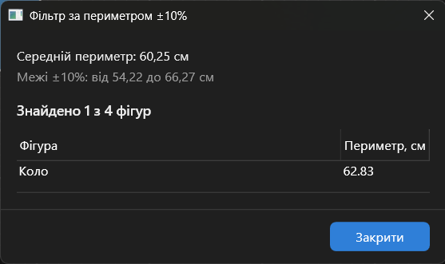
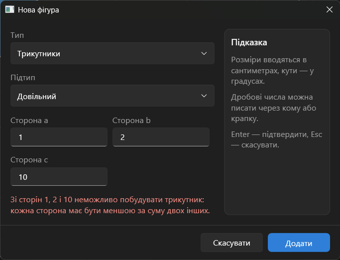

# Geometry Handbook

A desktop **geometry handbook** built with **C#, .NET 9, WPF and the MVVM pattern**.
The user chooses a figure type and subtype, enters its dimensions, and the app draws the figure on a centimetre grid and calculates all of its characteristics. It also shows the formulas with the values substituted in.

The project was created as coursework for the *Object-Oriented Programming* course at Lviv Polytechnic National University.

---

## 📌 About

Geometry Handbook is a **Windows desktop application** for building and exploring geometric figures.
It is designed using the **MVVM (Model-View-ViewModel)** pattern. All geometry logic lives in a separate class library that has no dependency on WPF, and the UI layer only displays and edits that model.

The user interface is in Ukrainian.

---

## 🗂 Project Structure

```
📦GeometryHandbook/
└── 📁 src/
    ├── 📁 GeometryHandbook.Core/   # Model — pure C#, no WPF
    │   ├── 📁 Figures/             # Figure hierarchy (Circle, Triangle, Parallelogram, ...)
    │   ├── 📁 Catalog/             # Figure types/subtypes and factories
    │   ├── 📁 Algorithms/          # Counting sort by area
    │   ├── 📁 Analysis/            # Perimeter ±10% analysis
    │   ├── 📁 Persistence/         # File I/O via overloaded << and >> operators
    │   └── 📁 Exceptions/          # Custom exception hierarchy
    └── 📁 GeometryHandbook.App/    # WPF UI layer
        ├── 📁 Views/               # Main window and dialogs (XAML)
        ├── 📁 ViewModels/          # UI logic and data binding
        ├── 📁 Commands/            # RelayCommand (ICommand)
        ├── 📁 Services/            # Dialog service (opens windows for ViewModels)
        ├── 📁 Drawing/             # Converts figures into WPF geometry
        └── 📁 Resources/           # Colors and styles
```

---

## 🛠 Technologies Used

| Category | Technologies |
|----------|--------------|
| Language | C# |
| Framework | .NET 9 (WPF) |
| Architecture | MVVM |
| UI theme | Built-in WPF Fluent theme (dark) |
| Persistence | Text file through overloaded `<<` / `>>` operators |
| IDE | Visual Studio |
| Patterns | Template Method, Factory, Command, Dialog Service |

---

## 📥 Getting Started

### 🔧 Prerequisites

- Visual Studio 2022 with the **.NET desktop development** workload installed
- .NET 9 SDK
- Windows 10 or 11

### 📁 Installation

1. Clone the repository:
   ```
   git clone https://github.com/ostrovka-cc/GeometryHandbook.git
   ```

2. Open the solution:
   - Open `GeometryHandbook.sln` in Visual Studio.
   - Make sure `GeometryHandbook.App` is the startup project.

3. Build and run:
   - Press **F5** or click **Run**.

---

## 🧠 Features

- 📐 **13 figures in 4 groups**
    - **Circle**
    - **Triangles** — scalene, equilateral, isosceles, right
    - **Quadrilaterals** — parallelogram, rectangle, square, rhombus, isosceles trapezoid
    - **Regular polygons** — n-gon, pentagon, hexagon
- ➕ **Add figures** — choose type and subtype in a separate dialog; input is validated
- ✏️ **Edit figures** — the same dialog opens pre-filled (uses the assignment operation `AssignFrom`)
- 🗑 **Delete figures** — toolbar, menu, context menu or the Delete key
- 🖼 **Drawing** — figures are drawn to scale on a grid (1 cell = 1 cm), with zoom via Ctrl + mouse wheel or touchpad pinch
- 📊 **Characteristics** — area, perimeter, sides, angles, inscribed and circumscribed circle radii, midlines, diagonals, height
- 🧮 **Formulas** — every formula is shown with the figure's actual values substituted
- 🎨 **Fill color** — paint the selected figure with one of 24 colors
- 🔍 **Scaling** — set the scale relative to the original size (1 = original)
- ↕️ **Sort by area** — counting sort
- 📏 **Perimeter filter** — a report of figures whose perimeter is within ±10% of the average
- 💾 **Save / Open** — store the list of figures in a text file and load it back
- ⌨️ **Shortcuts** — Ctrl+N, Ctrl+O, Ctrl+S, Delete, double click to edit

---

## 🧩 OOP Highlights

- **Inheritance hierarchy**: `Figure` → `Circle`, `Polygon` → `Triangle` / `Quadrilateral` / `RegularPolygon` → concrete subtypes
- **Abstract classes and methods**: `Area`, `Perimeter`, `GetProperties()`, `GetFormulas()`
- **Template Method**: `Scale()` and `AssignFrom()` validate input and delegate to `ScaleCore()` / `AssignCore()`
- **Constructors**: every figure has a default constructor and a constructor with parameters
- **Assignment operation**: `AssignFrom(Figure source)` copies the dimensions of a figure of the same type
- **Operator overloading**: `writer << figure` writes a figure to a file, and `reader >> list` reads figures from a file
- **Custom exceptions**: `FigureException`, `InvalidFigureDimensionsException`, `FigureFileFormatException`, `EmptyFigureCollectionException`
- **Derived values are computed, not stored**: area, perimeter and radii always follow the current dimensions

---

## 📄 File Format

One figure per line: the figure key, its fill color, and the constructor parameters, separated by `;` and using `.` as the decimal separator.

```
Circle;SteelBlue;5
```

---

## 📈 Architecture Overview

The application follows the **MVVM pattern**:

- **Model** (`GeometryHandbook.Core`) — figures, catalog, algorithms and file I/O, with no dependency on WPF
- **ViewModel** — commands, selected figure, validation messages, and change notifications for the UI
- **View** — WPF XAML windows bound to the ViewModels

ViewModels never create windows directly. They ask `IDialogService`, which keeps the UI logic testable and independent of WPF.

---

## 🖼️ Screenshots

### Main window


### Add new figure


### Edit figure (auto filled)


### Formulas with substituted values


### Fill color


### Scaling


### Sorted by area


### Perimeter ±10% report


### Input validation


---

## 👤 Author

**Petro Ostrovka** — student of Lviv Polytechnic National University, group PZ-24
